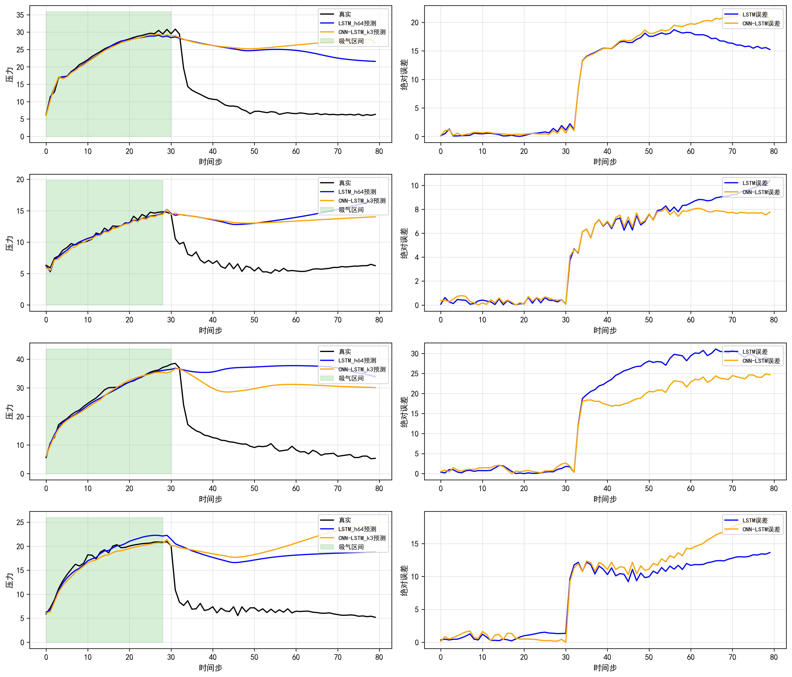

# CNN-LSTM for Ventilator Pressure Prediction

A time-series regression experiment on the Kaggle [Ventilator Pressure Prediction](https://www.kaggle.com/competitions/ventilator-pressure-prediction) competition dataset: predict airway pressure at each time step with an **LSTM baseline** and a **CNN-LSTM hybrid**, with controlled experiments over hidden dimension and kernel size.

Following the competition rules, the evaluation metric is **MAE computed only during the inhalation phase (`u_out = 0`)** — during exhalation the pressure is directly controlled by the valve and does not need to be predicted.

## Results

### Local test set (1,200 held-out breathing cycles)

| Model | Inhalation MAE ↓ | Full-sequence MAE | Full-sequence RMSE |
| :--- | ---: | ---: | ---: |
| LSTM (hidden=64) | 1.4085 | 8.6600 | 11.8651 |
| **CNN-LSTM (kernel=3)** | **1.3492** | 8.4975 | 11.8398 |

CNN-LSTM reduces the primary metric (inhalation MAE) by about **4.2%** compared to the LSTM baseline.

### Validation set: 4 hyperparameter configurations

| Model | Inhalation MAE ↓ | Full-sequence MAE | Full-sequence RMSE | Params | Training time (30 epochs) |
| :--- | ---: | ---: | ---: | ---: | ---: |
| LSTM_h32 | 1.7644 | 7.9838 | 10.8591 | 5,537 | 12.83s |
| LSTM_h64 | 1.5146 | 8.9987 | 12.5203 | 19,265 | 7.33s |
| **CNN-LSTM_k3** | **1.3890** | 10.3329 | 14.2139 | 26,049 | 7.82s |
| CNN-LSTM_k5 | 1.4349 | 11.3424 | 15.5206 | 26,625 | 18.38s |

> Note: CNN-LSTM achieves a lower inhalation MAE but a higher full-sequence error than LSTM. This is because its prediction error is larger during exhalation, which is excluded from the competition score. This is also why inhalation MAE is used as the model-selection criterion in this project.



Raw time-series plots of individual breathing cycles (u_in: inhalation valve, u_out: exhalation valve, pressure) are in [`figures/`](figures/).

## Method

- **Data split**: From 75,450 breathing cycles, 8,000 complete cycles are sampled with R/C stratification, then split 70% / 15% / 15% into train / validation / local test. The three sets have disjoint `breath_id`s.
- **Features**: `time_step` and `u_in` are standardized with `StandardScaler` (fitted on the training set only); `R` and `C` are one-hot encoded; `u_out` serves as the inhalation mask. No pressure statistics or lagged values are used as inputs.
- **Loss**: `MaskedMAELoss` computes MAE only at time steps where `u_out == 0`.
- **Models**:
  - `LstmBaseline`: single-layer unidirectional LSTM (hidden=64) → Linear.
  - `CnnLstm`: Conv1d (kernel=3, channels=32) + ReLU for local temporal features → single-layer LSTM → Linear.
- **Training**: Adam, lr=1e-3, 30 epochs, best weights saved by validation inhalation MAE.

## Requirements

Python 3.11+, dependencies are listed in [`requirements.txt`](requirements.txt):

```bash
pip install -r requirements.txt
```

## Data preparation

The raw data comes from the Kaggle competition and is **not included in this repository** due to its size and licensing. Download it with `kagglehub`:

```python
import kagglehub
path = kagglehub.competition_download("ventilator-pressure-prediction")
print("Path to competition files:", path)
```

Place the downloaded `train.csv` into the `data/` directory (i.e. `data/train.csv`). If stored elsewhere, set the environment variable:

```bash
export VENTILATOR_DATA_PATH=/your/path/to/train.csv
```

## Reproducing the results

```bash
# 1. Install dependencies
pip install -r requirements.txt

# 2. Download the data and place it at data/train.csv (see Data preparation)

# 3. Run full training + evaluation (re-trains all four variants and evaluates the best models)
python src/train.py

# 4. Or step through the interactive analysis notebook
jupyter notebook notebooks/pred_cnnlstm.ipynb
```

The training script saves `lstm_best.pt` and `cnn_lstm_best.pt` under `weights/`, and generates `four_samples.png` under `figures/`.

## Project structure

```
.
├── README.md
├── LICENSE
├── requirements.txt
├── data/                    # train.csv goes here (gitignored)
├── notebooks/
│   └── pred_cnnlstm.ipynb   # full analysis (outputs cleared)
├── src/
│   ├── config.py            # hyperparameters and paths
│   ├── data.py              # loading / splitting / feature engineering / Dataset
│   ├── models.py            # model definitions and MaskedMAELoss
│   └── train.py             # training entry: comparison + test evaluation + plotting
├── figures/                 # result figures
└── weights/                 # trained weights (.pt gitignored)
```

## License

[MIT](LICENSE)
